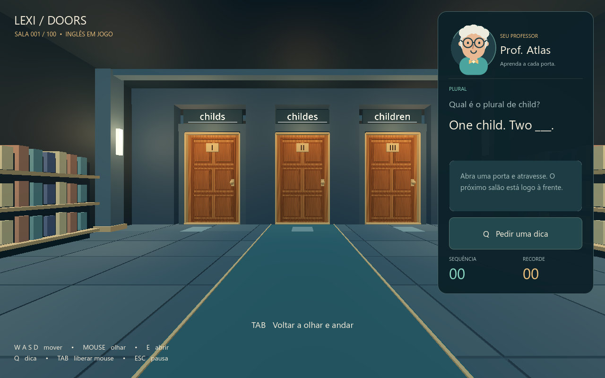
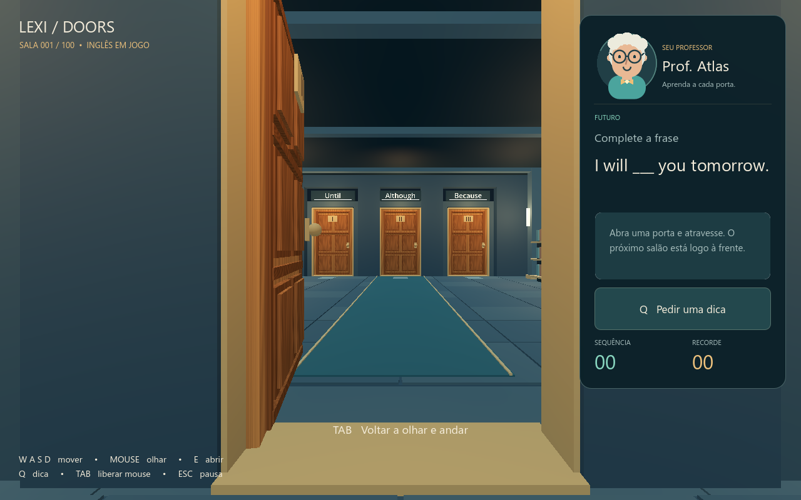

# LexiDoors

**Seu inglês abre caminhos.**

Jogo 3D em primeira pessoa para praticar inglês: três portas, uma resposta correta e uma campanha de 100 salas. Protótipo para Windows desenvolvido em Godot e GDScript.



## Ideia e autoria

Idealizei o **LexiDoors** para transformar a prática de inglês em um jogo de escolhas: o jogador precisa identificar a resposta correta para avançar por uma sequência de salas. Quis combinar o desafio de manter uma sequência de acertos com dicas e explicações que ajudam a aprender com os erros.

**Concepção e direção do projeto: Mateus Mendes.** Defini a proposta, as mecânicas, a interface do professor e a evolução do protótipo, solicitando e avaliando mudanças ao longo do desenvolvimento.

A implementação foi realizada com **assistência de inteligência artificial (Codex)**, a partir desses requisitos. O projeto faz parte do meu portfólio de concepção de jogos e prototipagem assistida por IA.

## Como funciona

1. Uma pergunta aparece no painel do professor Atlas.
2. Cada porta mostra uma alternativa em inglês.
3. O jogador pode pedir uma dica e abrir as portas para observar a continuação do salão.
4. Atravessar uma porta confirma a resposta.
5. O acerto mostra um check verde e permite continuar até a próxima sala.
6. O erro mostra um X vermelho, abre o alçapão e apresenta a correção. A campanha recomeça na sala 1.
7. Ao concluir as 100 salas, aparece a mensagem de parabéns.

O recorde pessoal é preservado. Cada partida usa 100 perguntas distintas, com ordem e alternativas embaralhadas.



## Recursos da versão 0.2

- Movimento em primeira pessoa, com teclado e mouse.
- Portas de madeira numeradas e salas conectadas sem teletransporte no acerto.
- 100 perguntas de vocabulário e gramática, com dicas e correções.
- Professor animado com expressões de espera, dica, acerto e erro.
- Feedback visual de acerto/erro e queda física pelo alçapão.
- Tela de conclusão, recorde local, pausa, volume e sensibilidade ajustáveis.
- Carregamento apenas da sala anterior, atual e seguinte para limitar o uso de memória.

## Estado da integração com IA

**A versão atual funciona offline.** As perguntas, dicas e explicações são locais; o professor ainda não utiliza um modelo de IA durante a partida.

Uma integração com a API do Gemini para dicas e explicações personalizadas está planejada para uma etapa futura. Nenhuma chave de API é necessária para executar esta versão.

## Jogar no Windows

O pacote executável deve ser baixado na seção **Releases** deste repositório, quando publicado.

Extraia o ZIP e execute `LexiDoors/Windows/LexiDoors.exe`. Mantenha o arquivo `LexiDoors.pck` ao lado do executável. Não é necessário instalar Godot para jogar.

O recorde e as preferências são salvos em `user-data`, ao lado do executável. A partida em andamento ainda não tem recurso de salvar e continuar depois.

| Controle | Ação |
| --- | --- |
| W, A, S, D | Andar |
| Mouse | Olhar |
| E | Abrir a porta à frente |
| Atravessar a porta | Confirmar a resposta |
| Q | Pedir dica |
| Tab | Liberar ou capturar o mouse |
| Esc | Pausar |
| F11 | Alternar tela cheia |

## Executar o código-fonte

1. Instale o **Godot 4.7.2 padrão**, sem necessidade da versão .NET.
2. Clone ou baixe este repositório.
3. Importe o arquivo `project.godot` no Godot.
4. Pressione **F5** para executar.

A sala e a interface são montadas por código durante a execução. Por isso, o cenário completo não aparece no editor antes de iniciar o jogo.

Para exportar, instale os templates do Godot da mesma versão, crie a pasta `builds` e use o preset **Windows Desktop** em **Projeto > Exportar**.

## Organização

```text
project.godot            Configuração do projeto
scenes/main.tscn         Cena inicial
scripts/main.gd         Campanha, interface e menus
scripts/room.gd         Salas conectadas e alçapões
scripts/player.gd       Movimento e câmera
scripts/door.gd         Portas e abertura
scripts/teacher.gd      Professor animado
scripts/feedback.gd     Check verde e X vermelho
scripts/quiz_bank.gd    Leitura e validação das perguntas
scripts/sound.gd        Efeitos sonoros
shaders/wood.gdshader   Material de madeira
data/questions.json    Banco de 100 perguntas
```

## Próximos passos

- Integrar o professor com a API do Gemini.
- Ampliar e revisar o conteúdo pedagógico.
- Explorar dificuldade adaptativa e novas variações visuais.
- Melhorar o acabamento a partir do feedback de jogadores.

O foco atual é computador. Uma versão para celular fica para o futuro.

## Créditos

- Concepção e direção: **Mateus Mendes**.
- Implementação assistida por IA: **Codex**.
- Motor: [Godot Engine](https://godotengine.org/), distribuído sob licença MIT.
- Geometria, professor, ícone, material de madeira e sons criados por código no projeto.
- Licenças e avisos do motor e de suas dependências: [CREDITOS.txt](CREDITOS.txt).
